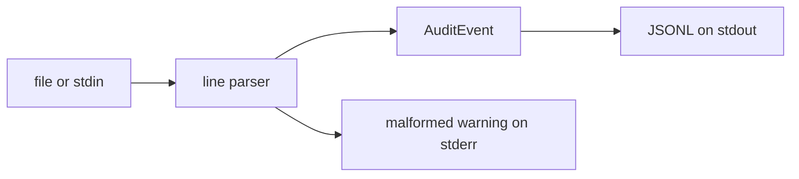

# AuditForge

AuditForge is a small Linux audit-event collector. It reads auditd log lines from a file or stdin, normalizes each record, and writes [JSON Lines](https://jsonlines.org/) to stdout.

The MVP reads audit data from userspace log files. It does not directly consume kernel audit events through netlink.

Target systems are Oracle Linux 8/9 and Fedora.

## Architecture

```text
audit log file or stdin
        |
        v
line-by-line parser
        |
        v
normalized audit event
        |
        v
JSON Lines on stdout
        |
        v
systemd service (auditforge run)
        |
        v
RPM package
```

`parse` reads its input once and exits. `run` reads the current file, then keeps following it until SIGTERM or SIGINT. Both commands use the same parser. A bad line is reported on stderr and does not stop the process.



## Installation

### From source

```bash
cargo build --release
sudo install -m 0755 target/release/auditforge /usr/bin/auditforge
sudo install -m 0644 packaging/auditforge.service /usr/lib/systemd/system/auditforge.service
sudo groupadd --system auditforge
sudo useradd --system --gid auditforge --home-dir /var/lib/auditforge \
    --shell /sbin/nologin auditforge
sudo install -d -o auditforge -g auditforge -m 0750 /var/lib/auditforge
```

### RPM

The spec builds the binary with Cargo. `cargo` and `rustc` must be on `PATH`. Create the source tarball with GNU tar (`--transform`), then build:

```bash
mkdir -p "$HOME/rpmbuild/SOURCES"
tar --exclude target --exclude .git \
    -czf "$HOME/rpmbuild/SOURCES/auditforge-0.1.0.tar.gz" \
    --transform 's,^,auditforge-0.1.0/,' \
    Cargo.lock Cargo.toml LICENSE README.md SECURITY.md CHANGELOG.md \
    src tests examples packaging
rpmbuild -ba packaging/auditforge.spec
rpm -qpl "$HOME/rpmbuild/RPMS"/*/*.rpm
rpm -qpR "$HOME/rpmbuild/RPMS"/*/*.rpm
```

Install and upgrade with `rpm -Uvh`. The package creates the `auditforge` system user if it is missing, installs the unit, and creates `/var/lib/auditforge`. It does not enable the service. Uninstall stops the unit and leaves any files already stored in `/var/lib/auditforge`.

Before enabling the service, grant the user read access to the audit log. That file is usually mode `0600`:

```bash
sudo setfacl -m u:auditforge:rx /var/log/audit
sudo setfacl -m u:auditforge:r /var/log/audit/audit.log
sudo systemctl daemon-reload
sudo systemctl enable --now auditforge.service
```

## Usage

```bash
auditforge parse --input sample-audit.log
auditforge parse --input -
auditforge run --input /var/log/audit/audit.log
auditforge version
```

```bash
auditforge parse --input examples/sample-audit.log
cat examples/sample-audit.log | auditforge parse --input -
```

Each input line becomes one JSON object. Fields that cannot be extracted are `null`. `raw` is always the original line. `uid` `0` is reported as `"root"`. Other numeric ids are left as decimal strings. Syscall numbers use a small x86_64 map (`2` and `257` become `"open"`).

## Sample input and output

Input (`examples/sample-audit.log`):

```text
type=SYSCALL msg=audit(1791115200.000:1234): arch=c000003e syscall=2 success=yes exit=3 a0=7ffc a1=0 items=1 ppid=100 pid=200 auid=0 uid=0 gid=0 euid=0 comm="cat" exe="/usr/bin/cat" key="open_watch"
```

Output:

```json
{"timestamp":"2026-10-04T12:00:00Z","event_id":"1234","record_type":"SYSCALL","operation":"open","user":"root","success":true,"raw":"type=SYSCALL msg=audit(1791115200.000:1234): arch=c000003e syscall=2 success=yes exit=3 a0=7ffc a1=0 items=1 ppid=100 pid=200 auid=0 uid=0 gid=0 euid=0 comm=\"cat\" exe=\"/usr/bin/cat\" key=\"open_watch\""}
```

A line that is not an audit record still produces JSON, and a message on stderr:

```json
{"timestamp":null,"event_id":null,"record_type":null,"operation":null,"user":null,"success":null,"raw":"this is not an audit record"}
```

## Development

```bash
cargo fmt --check
cargo clippy -- -D warnings
cargo test
cargo build --release
```

Release binary: `target/release/auditforge`.

## Tests

`cargo test` covers a valid record, several records, a malformed record, missing fields, empty input, stdin, a long line, JSON output, and SIGTERM while `run` is following a file.

## Security model

The process reads the log path it was given and writes JSON to stdout. The systemd unit runs as `auditforge`, restarts on failure, logs to the journal, and uses `/var/lib/auditforge` as its state directory. Hardening is `NoNewPrivileges`, `PrivateTmp`, `ProtectHome`, and `ProtectSystem=strict`, with read access limited to `/var/log/audit`.

Version 0.1 does not write files under `/var/lib/auditforge`. The directory is created for the service account and for later versions.

Details and the audit-log permission limitation are in [SECURITY.md](SECURITY.md).

## Known limitations

- The MVP reads audit data from userspace log files. It does not directly consume kernel audit events through netlink.
- `run` follows one regular file. It does not detect log rotation or a replaced inode.
- Only `uid` `0` is mapped to a name. Other ids stay numeric unless the record already contains `UID`, `AUID`, or `acct`.
- The syscall map is a small x86_64 table, not a full architecture database.
- Lines longer than 1 MiB are skipped with an error on stderr.
- There is no eBPF probe, database, REST API, web UI, or distributed collector.

## Roadmap

- Follow log rotation.
- Read audit events from netlink.
- Resolve more user and syscall names.
- Optional durable state under `/var/lib/auditforge`.
